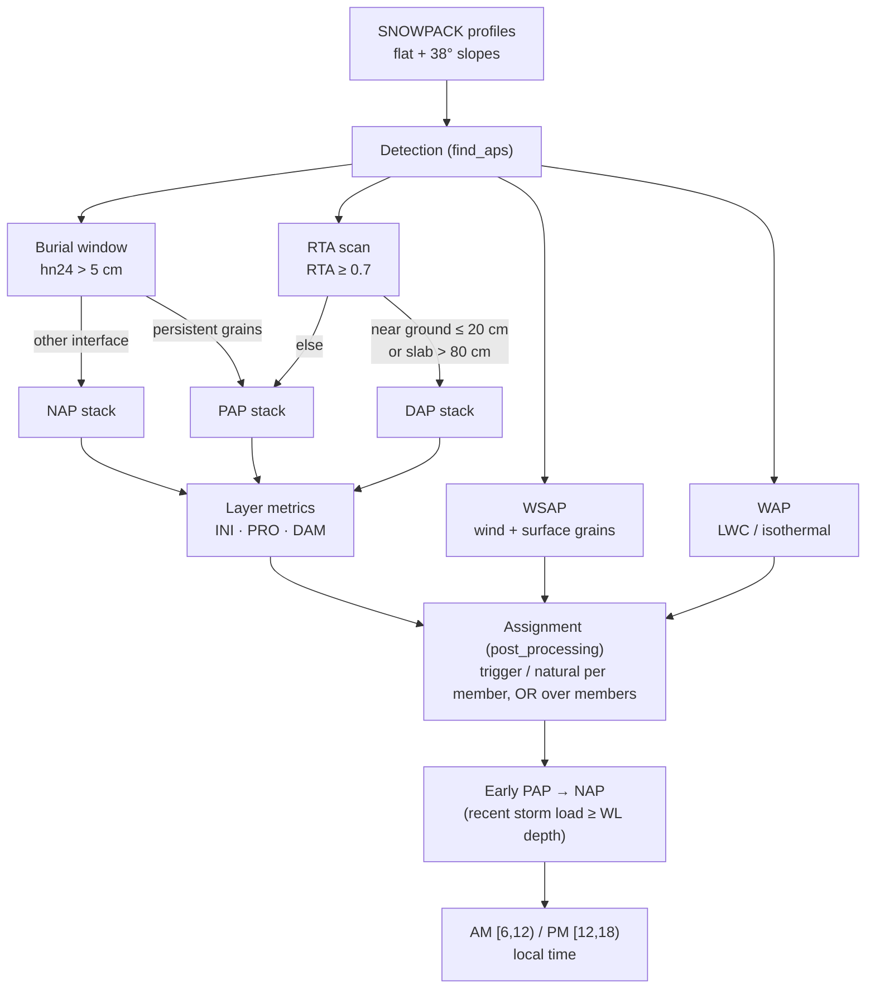

# VI. AvAPro

<p class="updated">Last updated: 25 Nov 2026</p>

**AvAPro** (Avalanche Problem) derives avalanche problems (storm slab, wind slab, persistent, deep persistent,
wet) from simulated snow profiles. It started as Ben Reuter's Matlab code for avalanche-problem climatologies, was
translated to Python at the Tyrolean avalanche warning service (supervision Christoph Mitterer; Michi Binder and
Martin Perfler), and was extended for North America (v2). **v3** (`avapro_xs`) brings it onto xsnow for the
snowpackbc chain.

| Version | Code | Input | Status |
|---|---|---|---|
| v1 | `main` | `.pro` / `.smet`, one weak layer at a time, daily 06 h / 15 h | baseline |
| v2 | `py-code/`, branch `hourly-find-aps` | `.pro` / `.smet` of point runs (AWS and HRDPS-at-station), flat + 8 aspects | reference, used for the ISSW 2026 validation |
| v3 | `avapro_xs/`, branch `avapro-v3` | `xsnowpack.zarr` of any AWSOME node (hex, grid, station; 5 or 9 slopes; any Δt) | in development |

More on v1/v2: [Documentation_ISSW → AvaPro v1 / v2](https://machtlp.github.io/Documentation_ISSW/).

## 1. Method (v2)



<p class="fig-caption"><strong>Figure 1.</strong> AvAPro v2: detection, stacks, assignment, AM/PM product.</p>

### 1.1 Detection

| Detector | Problem | Rule |
|---|---|---|
| **NAP** | Storm slab | burial window (once a day when `hn24 > 5 cm`) finds a new interface; kept while new snow / 48 h snow / slab criteria hold (`nsthrsh 0.2 m`, `minSLthrsh 0.20 m`, `minSLdens 120 kg m⁻³`); kept 3 days from burial, then only while it passes INI and PRO |
| **PAP** | Persistent slab | burial window over persistent grains (SH, FC, FCxr, DH, …), or the daily RTA scan (RTA ≥ 0.7) |
| **DAP** | Deep persistent | RTA-found persistent layer near the ground (≤ 20 cm) or under a deep slab (> 80 cm); own stack, PAP thresholds |
| **WSAP** | Wind slab | `VW_drift ≥ vw_thrsh` in the past 24 h with suitable surface grains; persists up to `vw_thrsh_days = 3` |
| **WAP** | Wet snow | LWC thresholds (`lwcthrsh 0.008`, `lwcthrsh_0 0.01`, `lwcthrsh_1 0.03`) and isothermal age ≤ `dysisomax` |

PAP, NAP and DAP are **stacks**: several members per step; near-duplicates within 0.3 m are merged; a day flag is
the OR over members.

### 1.2 Layer metrics and assignment

| Metric | Meaning |
|---|---|
| **INI** | initiation: weak-layer strength vs. skier load (SNOWPACK τp, CoJ15 ageing at night) |
| **PRO** | propagation: critical crack length (Gaume et al. 2017 / van Herwijnen et al. 2016) |
| **DAM** | natural release: load added since burial |

| Mode | Rule |
|---|---|
| Trigger | INI ≤ thr **and** PRO ≤ thr (NaN does not pass) |
| Natural | trigger **and** DAM ≤ thr |
| NAP thresholds | effectively open → existence-driven |
| PAP / DAP thresholds | `INI 1.31`, `PRO 0.42`, `DAM 18` |

**Early PAP → NAP:** a PAP that passes the trigger test is assigned as storm slab if the recent storm sum (last
3 days of `hn24`, extended up to 7 days while `hn24 > 5 cm`) is at least its weak-layer depth. On that AM/PM slot the
PAP flag is cleared.

### 1.3 Product

Hourly internally, published as **AM [6, 12)** and **PM [12, 18)** local time, OR over the hours. For daily InfoEx
nowcasts: calendar-day OR(AM, PM). See [Observations & Assessments](observations.md#4-validation-design).

## 2. v3 on xsnow (`avapro_xs`)

### 2.1 Goal

One code path for every AWSOME store, any number of aspects, any time step, and North American or European problem
sets from the `.ini`. Output: problems per location, slope and step, plus the dashboard key
`snowpack.avalanche_problem`.

### 2.2 Stages

| Stage | Module | What |
|---|---|---|
| 1 Load | `load.py` | open store, select slopes by coordinate, Δt, local time, forecast mask; band and `region_id` from `locations.json` |
| 2 Normalise | `normalise.py` | slope-normal geometry (× cos inclination), grain families, units, burial time per layer, rebuilt HN on 06 UTC dump steps |
| 3 Profile series | `profile.py` | hn24, hn48, drift, HS, 24 h VW max, evaluated flag, days without load, storm sum |
| A Layer metrics | `stage_a.py` | slab depth, density, E; τp, τg, σg; INI; PRO; candidates (stateless, vectorised) |
| B Tracking | `stage_b.py`, `stage_b_metrics.py`, `stage_b_states.py` | detection, member registry, keep/drop, CoJ15 ageing, DAM since burial, WSAP timer, WAP state |
| C Assignment | `stage_c.py` | trigger/natural per member, early PAP → NAP, OR over members, approach profile |
| D Publish | `publish.py`, `manifest.py` | AM/PM, aspect sectors, region × band, zarr + parquet + dashboard key |

### 2.3 Status (25 Nov 2026)

| Phase | Status |
|---|---|
| Config, load, normalise, profile series, 12 node configs | done |
| Stage A (layer metrics) | done |
| Stage B1–B4 (metrics, v2 registry with exact v2 parity on 32 runs, deposition-date tracking, WSAP/WAP) | done |
| Stage C (assignment) | next |
| Bridge test SC7a (v3 `v2_compat` reproduces v2 AM/PM flags) | to do |
| Stage D (publish), daily pipeline step | to do |

### 2.4 Configuration

```text
config_files/v3/base_north_america.ini      thresholds, approach profiles, [behaviour]
config_files/v3/nodes/<op>_<hex|grid|stn>.ini   [node] store, band_source, band table; timezone, slope_aspects, ...
```

No overrides: a key set in both files is an error. Each run records the sha256 of both files.

| Approach | Problems | Labels |
|---|---|---|
| `north_america` | NAP, WSAP, PAP, DAP, WAP | Storm Slab, Wind Slab, Persistent Slab, Deep Persistent Slab, Loose Wet / Wet Slab |
| `europe` (skeleton, not calibrated) | same detectors, DAP → PAP | New Snow, Wind-Drifted Snow, Persistent Weak Layers, Wet Snow |

`[behaviour]` switches cover every known v2 issue; the preset `v2_compat` reproduces v2, `v3_default` is the
corrected behaviour. The base config runs `preset = v2_compat` until bridge test SC7a passes. Examples:

| Switch | v2_compat | v3_default |
|---|---|---|
| `tracking` | `v2_height` | `deposition_date` (a member follows its date group; merges re-attach within 48 h) |
| `instab_mode` | `v2_daynight` | every step |
| `hour_clock` | `utc` | `local` |
| `rb15_slope_correction` | `double` (cos² on 38°) | `single` |

Time zones come from the pinned `tzdata` package (IANA 2026f), never from the system, so laptop and worker agree.

### 2.5 Output (planned)

| Output | Location |
|---|---|
| `avaprob.zarr` | `/opt/awsome/<node>/avapro/` (same `location × time × slope` coords as xsnow) |
| `members.parquet` | one row per tracked layer per step |
| `manifest.json` | config hashes, tzdata, `date_opera`, store path |
| dashboard key | `snowpack.avalanche_problem` in every feature of `<node>/geojson/<stamp>.<aspect>.json`: `storm_slab`, `wind_slab`, `wet_snow`, `persistent`, `deep_persistent` |

The dashboard already has the **Avalanche Problem** filter as a placeholder (`dcfg_semi.add_problem_filter`). The
daily step will run after `geojson_extras.py` and before `dcfg_semi.py`, inside the AWSOME Python, recomputing the
full season every day.

!!! warning "Experimental"
    Until the validation phase on the xsnow chain, every v3 output is labelled experimental. The v2 validation
    (NAP@TL, WAP@TL, PAP@ALP, WSAP@ALP at point sites) does not carry over to hexagons, grid cells or 4-aspect runs
    without the bridge tests.

### 2.6 Development

Each change runs through `/v3-cycle`: a developer agent implements, then code-reviewer, snowpack-expert and
scientific-reviewer check it against `docs/v3/RULES.md`; every cycle is logged in `docs/v3/REVIEW_LOG.md`.
Method changes against v2 are listed in `docs/v3/METHOD_CHANGES.md`.
