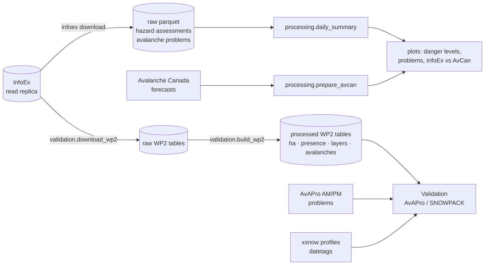

# VII. Observations & Assessments

<p class="updated">Last updated: 25 Nov 2026</p>

The model chain runs on weather input only. Field observations and forecaster assessments come in on a separate,
offline path: they are the reference the simulations and AvAPro are checked against. Two sources are used:

| Source | What | Access |
|---|---|---|
| **InfoEx** (Canadian Avalanche Association) | operational hazard assessments, avalanche problems, avalanche observations, weak-layer tracking, snowpack summaries of the four operations | read-only database replica, `infoex` Python package |
| **Avalanche Canada** | public forecasts (danger ratings per band, problems) for Banff, Whistler, Rogers Pass, MWHS regions | downloaded per season |

The weather-station observations that drive the Stations configuration are described under
[Weather Input §7](weather-input.md#7-weather-stations).

!!! info "Confidential data"
    InfoEx is industry information exchange between operations, not a public bulletin. This page describes the data
    types and the processing only; no InfoEx content is published here or on the dashboard.

## 1. Flow



<p class="fig-caption"><strong>Figure 1.</strong> From InfoEx and Avalanche Canada to the validation tables.</p>

## 2. The `infoex` package

Python tools for downloading and analysing InfoEx data. Credentials come only from environment variables / `.env`
(or the system keychain), the package only reads, and always from the read replica.

| Module | Content |
|---|---|
| `db.py` | connection settings and SQLAlchemy engine, `check_connection` |
| `operations.py` | operation catalog, search, registry of slugs (`banff_n`, `blackcomb`, `glacier_n`, `mike_wieg`) |
| `locations.py` | location layers (operating area, zones, runs, weather sites) → GeoJSON |
| `hazard.py` | hazard assessments, ratings per band, avalanche problems, weak layers (`pwl`, `pwl_assessment`) |
| `observations.py` | avalanche observations (with aspect/elevation flags and location centroids), daily avalanche summary, snowpack summaries |
| `validation.py` | WP2 validation tables |
| `inventory.py` | completeness checks: table inventory, fill rates, links, daily coverage |
| `processing.py` | `daily_hazard`, `daily_summary`, `prepare_avcan` |
| `plotting.py` | danger levels, problems overview, InfoEx vs Avalanche Canada |
| `cli.py` | `infoex` command |

```bash
infoex check                                       # test the connection
infoex operations Whistler                         # search the operation catalog
infoex download --ops all --seasons 2024/25 2025/26
infoex layers --ops banff_n --layers OpArea Zones  # GeoJSON
infoex available                                   # operation x season on disk
```

| Operation | InfoEx slug | Model operation |
|---|---|---|
| Banff National Park (north) | `banff_n` | Banff |
| Whistler Blackcomb | `blackcomb` | Whistler |
| Glacier National Park (north) | `glacier_n` | Rogers Pass |
| Mike Wiegele Heliskiing | `mike_wieg` | MWHS |

Seasons run 1 Nov – 30 May. Data from 2021/22 to 2025/26 is on disk.

## 3. What we use from InfoEx

### 3.1 Hazard assessments

One row per assessment, `character` = **nowcast** or **forecast**, with per band (`alp_`, `tl_`, `btl_`): danger
rating (`hzd`), confidence, stability, comment. `daily_hazard` keeps one assessment per day (the latest with a
danger rating).

### 3.2 Avalanche problems

Rows of the problem table with the problem type, nowcast/forecast, the aspects per elevation band, and the hazard
chart (likelihood × size). Problem types are mapped to one vocabulary:

| InfoEx character | Summary column |
|---|---|
| `STORM_SLAB` | Storm Slab |
| `WIND_SLAB` | Wind Slab |
| `PERSISTENT_SLAB` | Persistent Slab |
| `DEEP_PERSISTENT_SLAB` | Deep Persistent Slab |
| `LOOSE_DRY_AVALANCHE` / `DRY_LOOSE` | Dry Loose |
| `LOOSE_WET_AVALANCHE` / `WET_LOOSE` | Wet Loose |
| `WET_SLAB` | Wet Slab |
| `CORNICE` / `CORNICE_FALL` | Cornice |
| `GLIDE_AVALANCHE` / `GLIDE` | Gliding |

The hazard chart is parsed to size and likelihood on the 1–5 scales (`1 + 0.5 · value`, checked against depth and
sensitivity).

### 3.3 Observations

| Table | Use |
|---|---|
| Avalanche observations | date, size, trigger, aspect × elevation flags, location centroid; linked to weak layers where reported |
| Avalanche summary | daily `avalanches_observed`, `percent_area_observed` (observation effort) |
| Weak layers + layer assessments | layer name (e.g. `Jan 26 SH/MFcr/FC` → burial date + grain types), status over time, depth, bands |
| Snowpack summaries | free text with weak-layer links; context only |

## 4. Validation design

### 4.1 WP2 tables (grid configuration work plan §6)

`notebooks/05_wp2_validation_data.ipynb` builds the tables for one operation and season:

```python
from infoex import validation, inventory
raw = validation.download_wp2(engine, "glacier_n", "2025/26")
tables = validation.build_wp2(raw, "2025/26", character="nowcast")
validation.save_wp2(tables, "glacier_n", "2025/26")
inventory.requirements_check(tables)
```

| Table | Grain |
|---|---|
| `ha` | date × band × problem |
| `ha_bands` | date × band: danger rating, confidence, stability |
| `ha_presence` | dense date × band × aspect × problem (0 = not listed, NaN = no assessment) |
| `layer_assessments`, `layers_daily` | weak-layer status per day, listed in an assessment, avalanches on the layer |
| `layers_lookup` | one row per relevant weak layer (+ CSV for the manual match to model datetags) |
| `avalanches` | record × band |
| `aai_daily`, `obs_effort` | avalanche activity index, observation effort |

### 4.2 Matching model and truth

As in the v2 point validation (ISSW 2026):

| Model | InfoEx truth | Band |
|---|---|---|
| NAP (storm slab) | Storm Slab | TL |
| WSAP (wind slab) | Wind Slab | ALP |
| PAP (persistent) | Persistent Slab | ALP |
| WAP (wet) | Wet Loose / Wet Slab | TL |

- InfoEx **nowcast** problems are the truth; danger levels by band are context and filters.
- Model days before the first InfoEx day of the season are dropped (no truth).
- Daily InfoEx vs. AM/PM model: `y_pred = OR(AM, PM)` of the calendar day.
- Scores: day-exact and timing-tolerant contingency scores on the InfoEx-aligned window.

### 4.3 For the xsnow chain (next)

- The v2 validation was at **point sites** (station elevation = the InfoEx truth band). Hexagon × band and grid
  cells have their own model band from `locations.json`, so "validated" is redefined once the whole xsnow pipeline
  exists.
- Weak layers: InfoEx layer names (burial date) against the model's **datetags** per region × band.
- Avalanche observations with aspect × elevation flags against the slope-resolved problems.
- Avalanche Canada forecasts as a second, public reference.
