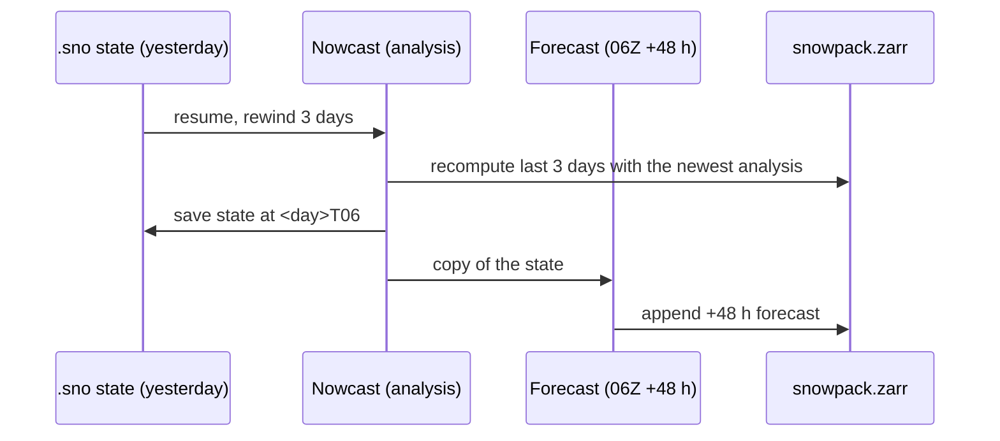

# IV. SNOWPACK

<p class="updated">Last updated: 25 Nov 2026</p>

SNOWPACK (SLF) is run by AWSOME's `atoolchain` inside the `awsome` container, once per node and day. The recipe
decides *what* is simulated (locations, slopes, sources, post-processing); the SNOWPACK ini comes from AWSOME's
`profsnow` templates (flavour `nwp`), with per-point snippets from our SMET generators.

## 1. Run setup (recipe)

All three recipes share the same `snowpack` section (`configs/hex_v2_recipe.yaml`, anchor `&snowpack`):

```yaml
run:
  season_start: "2026-10-04"     # HRDPS archive start
  season_end:   "2027-05-31"
  date_opera:   now              # daily run: --date-opera <day>T06:00
  ncpus: 2
terrain:
  aspects: [N, E, S, W]          # stations: N NE E SE S SW W NW
  angles:  [38]                  # flat is added automatically
snowpack:
  flavor: nwp
  flavor-pre: nwp-pre
  resume: true
  restart: false
  allow_partial: true
  output_format: zarr
  snippets: /ext_awsome/<config>/smet/snippets
```

| Key | Meaning |
|---|---|
| `flavor` / `flavor-pre` | ini templates `nwp.ini` (paths, slopes) on top of `nwp-pre.ini` (physics, output, filters) |
| `resume: true` | every run continues from the saved `.sno` state (`<node>/snow-nowcast/`) |
| `restart: false` | no cold start unless the state is missing |
| `allow_partial: true` | a failing location does not fail the node |
| `output_format: zarr` | SNOWPACK's ZarrIO plugin writes `snowpack.zarr` (needs the `feat/zarr-plugin-aw` build) |
| `snippets` | per-point ini fragments: `PSUM::GENERATOR1 = CST 0` (see below) |

### 1.1 Data sources per node

Same pattern as AWSOME's `gridded.yaml`, all three read our SMET folders through adatahub's built-in local SMET
source (`source: smet`, `provider: point`):

| Source | Role | Window | Purpose |
|---|---|---|---|
| `history` | backfill | season | season-to-date nowcast; no-op once covered |
| `nowcast` | update | operational, `days_past: 3` | rewinds 3 days so the analysis overwrites yesterday's forecast hours |
| `forecast` | update | operational, `days_past: 0`, `lead_time: 2` | 06Z run, +48 h |

A season-mode update would only extend from the hub cursor, which sits at the end of the previous forecast: the
resume would then never replace forecast hours with analysis. Hence the operational `nowcast` source.

### 1.2 Locations and bands

`locations.builder: geojson` reads the generator's `locations.geojson` (Point, `station_id`, `altitude`); the region
comes from `regions.geojson` by point-in-polygon; bands from `elevation_bands {edges, names}` (points below the
first edge are dropped). The SMET `station_id` and the location id must be identical: the hub merges by label.

## 2. Daily cycle



<p class="fig-caption"><strong>Figure 1.</strong> Resume: the nowcast advances the saved state, the forecast runs from a copy.</p>

- Output every **3 h** (`PROF_DAYS_BETWEEN = TS_DAYS_BETWEEN = 0.125`), first step 4 Oct 01:00.
- Resume tick (no new data) costs ~13 s per hex node; a cold season run of `mwhs_hex` took 84 s for SNOWPACK.
- The 06Z record of each restart is the initial-state dump: `HN*`, `MS_*` and `wind_trans24` are 0 there
  (see [Weather Input §8](weather-input.md#8-weather-values-for-the-dashboard)).

## 3. Slopes

| Configuration | Slopes |
|---|---|
| Semi-distributed, fully gridded | flat + 38° N, E, S, W (5) |
| Stations | flat + 38° N, NE, E, SE, S, SW, W, NW (9) |

All slopes use the same weather series (no radiation or wind redistribution by aspect beyond SNOWPACK's own slope
radiation). Heights in the output are **vertical** (m above ground) on every slope.

## 4. ini: `nwp-pre.ini` (main settings)

Settings from AWSOME's `profsnow/snowpack/templates/nwp-pre.ini`. `PLACEHOLDER` values are filled by atoolchain
(coordinates, paths, number of slopes). The worker runs a pinned AWSOME version; check the template there before
quoting a value in a paper.

=== "[SNOWPACK]"

    | Key | Value |
    |---|---|
    | `CALCULATION_STEP_LENGTH` | 15 min |
    | `HEIGHT_OF_METEO_VALUES` / `HEIGHT_OF_WIND_VALUE` | 2 m / 10 m |
    | `ROUGHNESS_LENGTH` | 0.002 m |
    | `ENFORCE_MEASURED_SNOW_HEIGHTS` | FALSE → **precipitation-driven**, no HS assimilation |
    | `SW_MODE` | INCOMING |
    | `ATMOSPHERIC_STABILITY` | MO_HOLTSLAG |
    | `CANOPY` / `SNP_SOIL` | 0 / FALSE (no soil: layer 0 = bottom snow element) |
    | `MEAS_TSS` / `CHANGE_BC` | FALSE / FALSE |

=== "[SNOWPACKADVANCED]"

    | Key | Value |
    |---|---|
    | `VARIANT` / `RESEARCH` | DEFAULT / TRUE |
    | `SNOW_EROSION` / `SNOW_REDISTRIBUTION` | FALSE / FALSE → **no wind drift** modelled |
    | `ALLOW_ADAPTIVE_TIMESTEPPING` | TRUE |
    | `THRESH_RAIN` | 1.2 °C |
    | `FORCE_RH_WATER` / `THRESH_RH` | TRUE / 0.5 |
    | `HOAR_THRESH_TA` / `_RH` / `_VW` | 1.2 °C / 0.97 / 3.5 m/s |
    | `HOAR_DENSITY_BURIED` / `HOAR_MIN_SIZE_BURIED` / `HOAR_DENSITY_SURF` | 125 kg m⁻³ / 2.0 mm / 100 kg m⁻³ |
    | `MIN_DEPTH_SUBSURF` | 0.07 m |
    | `NEW_SNOW_GRAIN_SIZE` | 0.3 mm |
    | `METAMORPHISM_MODEL` / `STRENGTH_MODEL` / `VISCOSITY_MODEL` | DEFAULT |
    | `WATERTRANSPORTMODEL_SNOW` | BUCKET |
    | `ENABLE_VAPOUR_TRANSPORT` | TRUE |
    | `SW_ABSORPTION_SCHEME` | MULTI_BAND |
    | `HARDNESS_PARAMETERIZATION` | MONTI |
    | `HEIGHT_NEW_ELEM` / `MINIMUM_L_ELEMENT` | 0.02 m / 0.0025 m |
    | `COMBINE_ELEMENTS` | TRUE (merged elements keep the upper deposition date) |
    | `SSI_IS_RTA` / `MULTI_LAYER_SK38` | TRUE / TRUE (output hacks: SSI column = RTA, SK38 per layer) |

=== "[INTERPOLATIONS1D]"

    | Field | Resampling |
    |---|---|
    | TA, RH, VW, ISWR | LINEAR, extrapolate |
    | PSUM | ACCUMULATE, period 900 s |

=== "[FILTERS]"

    | Field | Hard limits | Soft limits |
    |---|---|---|
    | TA | 200–320 K | 200–320 K |
    | RH | 0.01–1.2 | 0.05–1.0 |
    | VW | −2–70 m/s | 0–50 m/s |
    | ISWR / OSWR | −10–1500 W m⁻² | 0–1500 W m⁻² |
    | ILWR | 188–600 W m⁻² | 200–400 W m⁻² |
    | TSG | 200–320 K | — |

=== "[GENERATORS] + snippets"

    | Field | Generator |
    |---|---|
    | TSG | CST 273.15 K (ground at 0 °C) |
    | PSUM *(snippet, per point)* | CST 0 → fills the first step, which `ACCUMULATE` cannot compute after a cold start |

=== "[OUTPUT]"

    | Key | Value |
    |---|---|
    | `PROF_WRITE` / `TS_WRITE` | TRUE / TRUE |
    | `PROF_DAYS_BETWEEN` / `TS_DAYS_BETWEEN` | 0.125 d (3 h) |
    | `PROF_FORMAT` | PRO in the template; atoolchain switches to the ZarrIO output for `output_format: zarr` |
    | `HARDNESS_IN_NEWTON` | FALSE |
    | `OUT_HAZ`, `OUT_STAB`, `OUT_MASS`, `OUT_METEO`, … | TRUE |
    | `TIME_ZONE` | 0 (UTC) |

## 5. After SNOWPACK (atoolchain steps)

| Step | Output | Settings |
|---|---|---|
| `xsnowpack` | `xsnowpack.zarr` (full layer profiles, see [xsnow](xsnow.md)) | `chunks: profile` |
| `indices` | per-layer stability indices | `rc_flat, sk38, lwc, punstable, rta, sk38_ccl, sk38_ccl_rta` |
| `pwl` | persistent weak layer flags | grain types `SH, DH, FCxr, FC`; FCxr/FC need Punstable ≥ 0.77 |
| `datetags` | layers grouped by the precipitation event that buried them | `group_by: [region_id, band]` |
| `simplified` | `simplified.zarr`: most critical layer per index, location, slope and time | `geojson: true` |
| `dashboard` | `geojson/<stamp>.<aspect>.json` (6-hourly, whole season), `dcfg/operational.json` | `mode: gridded`, `display: geojson` |

Post-processing code: [atoolchain](https://gitlab.com/avalanche-warning/snow-cover/model-chains/atoolchain),
[punstable](https://gitlab.com/avalanche-warning/snow-cover/postprocessing/instability/punstable),
[pwl](https://gitlab.com/avalanche-warning/snow-cover/postprocessing/instability/pwl),
[datetags](https://gitlab.com/avalanche-warning/snow-cover/postprocessing/instability/datetags),
[pwet](https://gitlab.com/avalanche-warning/snow-cover/postprocessing/pwet).

## 6. Run times (t3.large, 2 vCPU)

| Node | Cold season run | Notes |
|---|---|---|
| `mwhs_hex` (21 locations × 5 slopes) | 2 min 24 s (SNOWPACK 84 s, xsnowpack 38 s) | to 3 Nov 2026 |
| `whistler_grid` (259 cells) | 58 min | first grid run |
| `rogers_grid` / `banff_grid` / `mwhs_grid` | 31 / 42 / 45 min | `simplified` is the slowest step (~8 min per node) |
| station nodes | 1.3–1.7 min | |

Daily runs are incremental (one day + forecast) and much shorter.

## 7. Commands

```bash
# inside the container
atoolchain /ext_awsome/hex_v2/hex_v2_recipe.yaml --toolchain mwhs_hex --date-opera 2026-11-03T00:00
atoolchain <recipe> --dry-run          # plan the steps of every node
atoolchain needs <recipe>              # install requirements
```
