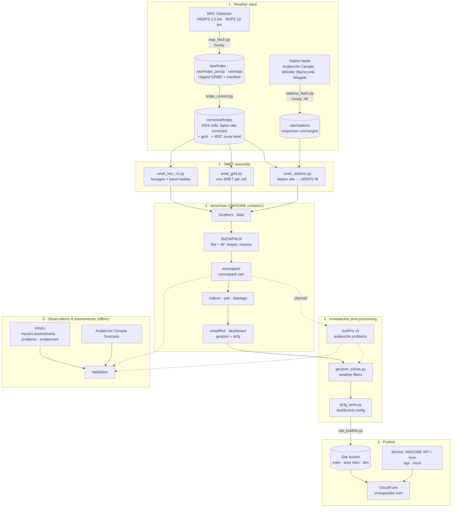
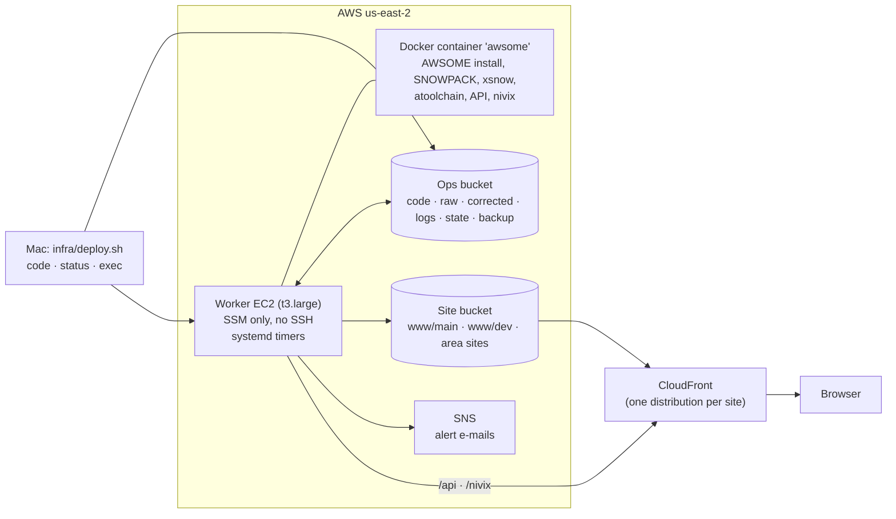

# II. Tool Chain Overview

Last updated: 25 Nov 2026

One HRDPS download feeds three model configurations. Every configuration runs SNOWPACK through AWSOME's
`atoolchain`, gets the same post-processing, and ends up on the dashboard. Observations and forecaster assessments
come in on a separate path and are used to check the model, not to drive it.

## 1. Flow chart

<strong>Figure 1.</strong> The snowpackbc tool chain. Solid lines run every day; dashed lines are planned or offline
(AvAPro v3 is in development, validation runs on the analysis machine).

## 2. Steps in one table

| # | Step | Script / tool | Input → output | Page |
|---|---|---|---|---|
| 1 | Fetch NWP | `ingest/nwp_fetch.py` | Datamart → `raw/<model>/YYYY/MM/DD/*.grib2` | [Weather Input](weather-input.md#2-download) |
| 2 | Correct | `pipeline/hrdps_correct.py`, `pipeline/lapse.py` | raw GRIB2 → `corrected/hrdps/.../HRDPS_<run>_cells.nc` | [Weather Input](weather-input.md#3-correction-to-cell-elevation) |
| 2b | Side products | `hrdps_correct.py --gust-pending`, `pipeline/snlvl_fetch.py` | → `_gust.nc`, `_snlvl.nc` | [Weather Input](weather-input.md#5-side-products) |
| 3 | Station poll | `ingest/stations_fetch.py` | provider pages → `raw/stations/...` | [Weather Input](weather-input.md#7-weather-stations) |
| 4 | SMETs | `smet_hex_v2.py`, `smet_grid.py`, `smet_stations.py` | corrected cells (+ stations) → `<domain>/{nowcast,forecast}/*.smet` | [Weather Input](weather-input.md#6-smet-assembly) |
| 5 | Model | `atoolchain <recipe> --toolchain <node>` | SMETs → `snowpack.zarr`, `xsnowpack.zarr`, indices, geojson | [SNOWPACK](snowpack.md), [xsnow](xsnow.md) |
| 6 | Extras | `pipeline/geojson_extras.py` | `snowpack.zarr` + gust + snow level → `weather.*` in each geojson feature | [Weather Input](weather-input.md#8-weather-values-for-the-dashboard) |
| 7 | Avalanche problems | `avapro_xs` (v3, in development) | `xsnowpack.zarr` → `snowpack.avalanche_problem` | [AvAPro](avapro.md) |
| 8 | Dashboard config | `pipeline/dcfg_semi.py` | `dcfg/operational.json` (sources, filters, colours, help texts) | — |
| 9 | Publish | `pipeline/site_build.py`, `pipeline/site_publish.py` | build + geojson + dcfg → site bucket, CloudFront invalidation | — |
| 10 | Warm + state | `daily_hex.py` steps `warm`, `state` | pre-load API caches; `.sno` state and run reports → `state/<node>/<day>/` | — |

The daily orchestrator is `pipeline/daily_hex.py`: it runs steps 1–10 for the **semi-distributed** part, then the
**fully gridded** part, then the **stations** part. Each part has its own success stamp, so a retry repeats only the
part that failed, and a problem in the grid never holds back the hexagons.

## 3. Three configurations

| | Semi-distributed (hex v2) | Fully gridded (grid v1) | Stations (stations v1) |
|---|---|---|---|
| Recipe | `configs/hex_v2_recipe.yaml` | `configs/grid_v1_recipe.yaml` | `configs/stations_v1_recipe.yaml` |
| Settings | `configs/hex_v2.yaml` | `configs/grid_v1.yaml` | `configs/stations_v1.yaml` |
| Point | 15 km hexagon × elevation band | one HRDPS 2.5 km cell | one weather station |
| Forcing | hourly **median** of the member cells | the cell's own corrected series | station observation, gaps filled by HRDPS |
| Location id | `<hex>_<BTL\|TL\|ALP>`, e.g. `R1_ALP` | `<R\|M\|W\|B>_<i>_<j>` | station name |
| Region id | hexagon label | operation (`RP-01`, `MW-01`, `WH-01`, `BA-01`) | 1 km square per station |
| Slopes | flat + N/E/S/W at 38° | flat + N/E/S/W at 38° | flat + 8 aspects at 38° |
| Nodes | `*_hex` | `*_grid` | `*_stn` |

One atoolchain **node** = one configuration of one operation = one output folder `/opt/awsome/<node>/`.

## 4. Infrastructure

<strong>Figure 2.</strong> Where things run. The worker pulls its code from the ops bucket before every run; the
Mac only uploads code and starts commands.

| Piece | Role |
|---|---|
| `infra/stack.yaml` | CloudFormation: ops bucket, worker EC2 + IAM role, security group, SNS alerts, budget |
| `infra/bootstrap.sh` | Worker setup: micromamba env (eccodes, wgrib2, xarray, …), systemd units and timers, failure alerts |
| `infra/awsome_install.sh` | AWSOME install in the `awsome` container with pinned commits (`versions.json`) |
| `infra/deploy.sh` | Run on the Mac: `check`, `up`, `code`, `update`, `status`, `exec "<cmd>"`, `backfill` |
| `infra/cloudfront_dev.sh`, `infra/area_site.sh` | CloudFront: worker origin for `/api/*` and `/nivix/*`; area sites (e.g. `banff`, `mwhs`) |
| `frontend/build.sh` + `frontend/*.patch` | Dashboard frontend (AWSOME's `albina-admin-gui`) with the snowpackbc patches: semi-distributed display, aspect & elevation rose, weather filters, panel help |

**Static vs dynamic.** The map files (`<node>/geojson/*.json`, `dcfg/*.json`, region outlines) are static on S3. The
time-series chart (`/api/timeseries`, AWSOME's dashboard API) and the profile viewer (`/nivix/xs*`, nivix xserver)
need Python services reading the zarr stores, so CloudFront sends those paths to the worker.

## 5. Schedule

| Timer | When | What |
|---|---|---|
| NWP fetch | hourly at :20 UTC | archive every complete HRDPS / RDPS run not yet in `raw/` (96 h look-back) |
| Archive status | every 30 min | status page of the raw archive and the station feeds |
| Station fetch | hourly at :40 UTC | store every station response unchanged |
| NWP check | daily 15:05 UTC | e-mail if any run of the last 2 days is missing or incomplete |
| **Daily run** | **03:00 America/Vancouver**, retry 05:00 | `daily_hex.py`: hex → grid → stations, publish main + area sites |

At 03:00 Pacific the newest complete HRDPS run is **06Z**. The day's run uses it as the forecast (06Z + 48 h) and
the nowcast up to 06Z (`atoolchain --date-opera <day>T06:00`). The service runs with low CPU priority (`Nice 10`), the
web services with high priority, and has a 5 h timeout. Any failed step exits 1 and sends an alert e-mail; the site
keeps yesterday's data until a run succeeds.

## 6. Software versions

AWSOME is installed from its GitLab group at pinned commits (recorded in `versions.json` on the worker and in the
ops bucket). Two pins deviate from the defaults (state 3 Nov 2026):

| Component | Pin | Why |
|---|---|---|
| SNOWPACK | branch `feat/zarr-plugin-aw` (3.7.1+aw) | the default deb has no ZarrIO plugin, but `output_format: zarr` needs it |
| xsnow | branch `feat/adashboard` | atoolchain imports `ZarrTailSlopeMismatch`, which only that branch has |

A reinstall must set `AWSOME_VERSION_SNOWPACK=feat/zarr-plugin-aw`.

## 7. Repository layout

| Folder | Content |
|---|---|
| `ingest/` | `config.yaml` (models, variables, clip box), `nwp_fetch.py`, `nwp_check.py`, `nwp_status.py`, `stations.yaml`, `stations_fetch.py` |
| `pipeline/` | correction, SMET generators, `daily_hex.py`, `geojson_extras.py`, `dcfg_semi.py`, `site_build.py`, `site_publish.py` |
| `configs/` | SMET settings and atoolchain recipes per configuration |
| `static/` | hexagon polygons (`hex_grid_fit_v2/`), HRDPS cells (`cells/`), operation outlines (`ops-regions/`) |
| `infra/` | CloudFormation, bootstrap, deploy, CloudFront scripts |
| `frontend/` | dashboard patches and build script |
