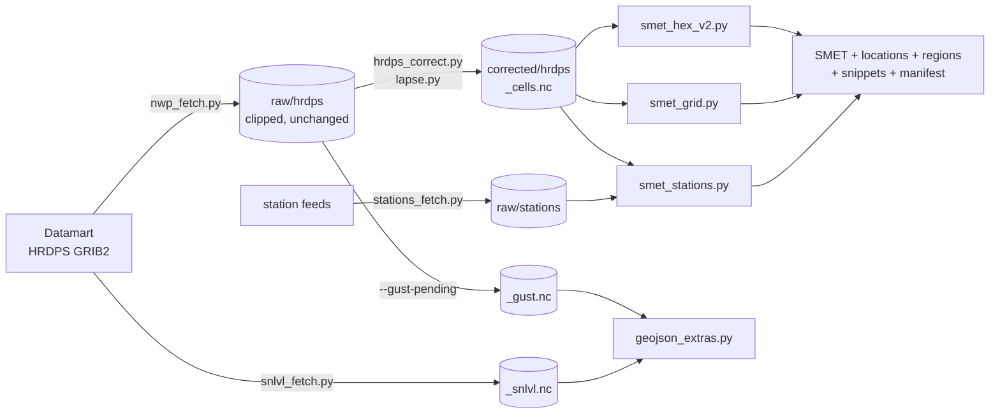
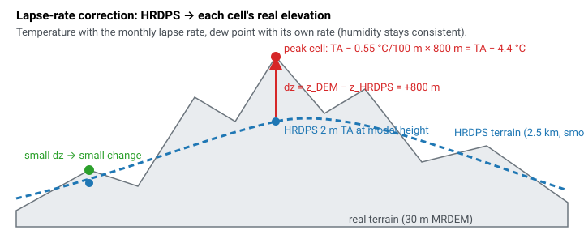
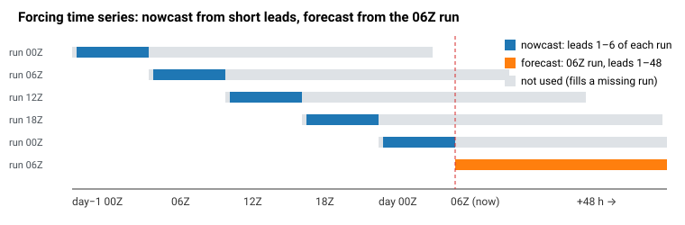

# III. Weather Input

<p class="updated">Last updated: 25 Nov 2026</p>

Every configuration is driven by the same weather: HRDPS, downloaded once, corrected once to the elevation of each
2.5 km cell, and then assembled into SMET files per model point. The station configuration adds observations from
the operations' weather stations on top.



<p class="fig-caption"><strong>Figure 1.</strong> Weather data from Datamart to the SNOWPACK input files.</p>

## 1. Data we pull

### 1.1 HRDPS (SNOWPACK forcing)

ECCC/MSC **High Resolution Deterministic Prediction System**, 2.5 km, continental domain, runs **00/06/12/18Z**,
hourly leads **0–48**. Settings in `ingest/config.yaml`.

| SMET field | Datamart file pattern | Notes |
|---|---|---|
| TA | `_TMP_AGL-2m_` | 2 m air temperature |
| RH | `_RH_AGL-2m_` | 2 m relative humidity |
| VW | `_WIND_AGL-10m_` | 10 m wind speed |
| DW | `_WDIR_AGL-10m_` | 10 m wind direction |
| ISWR | `_DSWRF_Sfc_` | incoming shortwave radiation |
| ILWR | `_DLWRF_Sfc_` | incoming longwave radiation |
| PSUM | `_MSC_HRDPS-WEonG_APCP_Sfc_` | precipitation, accumulated since run start |
| GUST *(optional)* | `_GUST_AGL-10m_` | 10 m gust, dashboard only |
| HGT *(optional)* | `_HGT_Sfc_` | model orography (lead 0) |

A run counts as complete only when every required field exists for every lead.

### 1.2 Further NWP archives (not used by SNOWPACK yet)

| Model key | What | Why |
|---|---|---|
| `hrdps_precip` | plain HRDPS model precipitation: `APCP` (since run start), `APCP-Accum1h` (hourly), `PRATE` | decided as the future PSUM source (instead of WEonG); archived and backfilled to 4 Oct 2026, the switch in `hrdps_correct.py` is still to do |
| `rdps` | RDPS 10 km, leads 0–84, same variables (long Datamart names, radiation accumulated) | day-3 forecast and HRDPS fallback later |

### 1.3 MSC snow level

`HRDPS-WEonG HGTSNLVL_Sfc` (m), read by `pipeline/snlvl_fetch.py` for the dashboard's comparison filter. It is
kept **out of** the raw archive on purpose: cfgrib may call it `unknown`, the same name as the WEonG precipitation, so
it could end up as PSUM.

### 1.4 Weather stations

See [§7](#7-weather-stations).

## 2. Download

`ingest/nwp_fetch.py`, hourly at :20 UTC (systemd timer), 96 h look-back.

- **Source:** MSC Datamart, dated tree first (`https://dd.weather.gc.ca/{date}/WXO-DD`), then the "today" tree.
  Datamart keeps about 30 days.
- **Clip:** BC/Alberta box, lon −132…−110°, lat 48…57°, cut as an **index sub-box** on the native rotated grid
  (`wgrib2 -ijsmall_grib`). Values are not changed.
- **Archive:** one file per run in the ops bucket, the same name the old cluster used, so `grib2smet.py` and later
  reanalyses read it unchanged:

```text
raw/hrdps/YYYY/MM/DD/HRDPS_YYYYMMDDHH.grib2
raw/hrdps/YYYY/MM/DD/HRDPS_YYYYMMDDHH.manifest.json      <- written last = "run complete"
raw/hrdps_precip/YYYY/MM/DD/HRDPS_PRECIP_YYYYMMDDHH.grib2
raw/rdps/YYYY/MM/DD/RDPS_YYYYMMDDHH.grib2
```

- **Idempotent:** runs whose manifest says complete are skipped. `raw/` moves to Glacier Instant Retrieval after 30 days.
- **Checks:** `ingest/nwp_check.py` (daily 15:05 UTC) e-mails when a run of the last two days is missing or
  incomplete; `ingest/nwp_status.py` writes a status page every 30 min.
- **Season start:** the archive starts **4 Oct 2026**, so every simulation cold-starts on that day.

```bash
nwp_fetch.py                                   # every run in the look-back window not yet archived
nwp_fetch.py --model hrdps --date 20261102 --run 06
nwp_fetch.py --list hrdps                      # file names Datamart offers (to check the regexes)
```

## 3. Correction to cell elevation

`pipeline/hrdps_correct.py` with `pipeline/lapse.py`. One archived run in, one NetCDF out:

```text
corrected/hrdps/YYYY/MM/DD/HRDPS_YYYYMMDDHH_cells.nc
  dims (cell, time)   time = valid time of leads 1..48 (hourly values ending at that time)
  vars TA RH VW DW ISWR ILWR PSUM in SMET units (°C, %, m/s, °, W/m², mm/h) + TA_raw, RH_raw
```

### 3.1 Points

**1664 points** = the HRDPS cells of the four operations (`static/cells/all_operations_hrdps_corrected.geojson`).
Each point has

- `z` = median **MRDEM-30** (NRCan 30 m DEM) of the cell clipped to the operation polygon,
- `z_hrdps` = HRDPS model orography at the nearest grid node,
- `dz_hr = z − z_hrdps`.

Every generator indexes cells by position, so every corrected file must hold the same cells in the same order. Cells
added later are appended at the end (`--add-missing-cells`), and existing ones stay bit-identical.

### 3.2 Steps

1. **Nearest cell:** each point takes the nearest HRDPS grid node.
2. **Units:** K → °C. Accumulated fields (`stepType=accum`: APCP, radiation if delivered as J/m²) are de-accumulated
   to hourly values; the decision per field is logged and stored in the file attributes.
3. **Lapse-rate correction** of TA and RH from `z_hrdps` to `z` (same method as Avalanche Canada's `grib2smet.py`,
   ported unchanged from the R original; monthly rates after Marsh (2024), Kunkel (1989), Shea et al. (2004)):

    - `TA_corr = TA − dz · Γ_T(month)`
    - RH via the dew point: RH → vapour pressure (Magnus) → Td → `Td_corr = Td − dz · (c/b) · λ(month)` → RH from
      `Td_corr` and `TA_corr`.
    - PSUM, radiation and wind are **not** changed.

| Month | J | F | M | A | M | J | J | A | S | O | N | D |
|---|---|---|---|---|---|---|---|---|---|---|---|---|
| Γ_T (°C km⁻¹) | 4.4 | 5.9 | 7.1 | 7.8 | 8.1 | 8.2 | 8.1 | 8.1 | 7.7 | 6.8 | 5.5 | 4.7 |
| λ (km⁻¹) | 0.41 | 0.42 | 0.40 | 0.39 | 0.38 | 0.36 | 0.33 | 0.33 | 0.36 | 0.37 | 0.40 | 0.40 |



<p class="fig-caption"><strong>Figure 2.</strong> Lapse-rate correction: peaks get colder, valleys warmer.</p>

!!! warning "RH method: `fixed`, not `grib2smet`"
    The original `grib2smet.py` adds 273.15 inside the Magnus formula, which expects °C. RH is then inflated even at
    `dz = 0` (−5 °C / 80 % → 94 %) and hardly reacts to `dz`. snowpackbc uses `RH_METHOD=fixed` (since 3 Nov 2026):
    RH stays unchanged at `dz = 0`. Season median RH went from 92 % to 70 % (raw HRDPS: 70 %); HS changed mostly by
    1–2 cm. `TA_raw` / `RH_raw` stay in every file, so the old method can always be recomputed for comparison.

```bash
hrdps_correct.py --pending              # every archived run without a corrected file (daily run)
hrdps_correct.py --date 20261101 --run 00
hrdps_correct.py --recompute-rh         # rewrite TA/RH of all files from TA_raw/RH_raw
```

## 4. Nowcast and forecast stitching

The SMET generators build two hourly series per point from the corrected runs:

| Series | Rule |
|---|---|
| **nowcast** | each hour *t* takes the newest run *R* with 1 ≤ *t* − *R* ≤ 6 h (leads 1–6 of the 00/06/12/18Z runs); if that run is missing, the next older run covering *t* (lead ≤ 48) fills it |
| **forecast** | the day's **06Z** run, leads 1–48 |



<p class="fig-caption"><strong>Figure 3.</strong> Nowcast from the first 6 h of each run, forecast from the 06Z run.</p>

!!! danger "Gaps stop the run"
    The manifest counts `gap_hours` (hours no run covers). The daily run **stops if `gap_hours > 0`**: the PSUM
    snippet (§6.4) would otherwise turn missing precipitation into 0 mm.

## 5. Side products

Not SNOWPACK forcing; used only for the dashboard's weather filters.

| Product | Script | Content |
|---|---|---|
| `HRDPS_<run>_gust.nc` | `hrdps_correct.py --gust-pending` | 10 m gust (m/s), nearest cell, no correction, leads 1–48 |
| `HRDPS_<run>_snlvl.nc` | `snlvl_fetch.py --forecast-run <run>` | MSC snow level (m) at every cell; NaN where MSC gives a negative code (no precipitation); leads 1–6 per run, 1–48 for the forecast run; only runs still on Datamart (backfilled from 12 Oct 2026) |

## 6. SMET assembly

Three generators, one per configuration, all reading the corrected cells. Each writes per domain:

```text
<config>/smet/<domain>/nowcast/<id>.smet     season-to-date nowcast
<config>/smet/<domain>/forecast/<id>.smet    06Z run, leads 1-48
<config>/smet/<domain>/locations.geojson     one Point per SMET (station_id = SMET id, altitude)
<config>/smet/<domain>/regions.geojson       polygons, id = region_id
<config>/smet/snippets/<id>.ini              per-point SNOWPACK ini snippet
<config>/smet/manifest.json                  period, forecast run, gap_hours, members / donors
```

The daily run writes into a fresh folder and swaps it in only on success.

### 6.1 Semi-distributed: `smet_hex_v2.py`

- Hexagons: `static/hex_grid_fit_v2/<op>.geojson` (15 km), bands: `configs/hex_v2.yaml`.
- A cell belongs to hexagon *H* and band *B* if its **centre** lies in *H* and its integer altitude lies in *B*.
- One point per hexagon × band: the hourly **median** of the members for TA, RH, VW, ISWR, ILWR, PSUM; a
  **circular mean** for DW. Altitude = median member altitude; position = hexagon centre.
- Id `<hex>_<BTL|TL|ALP>`, region id = hexagon label.

### 6.2 Fully gridded: `smet_grid.py`

- One point per HRDPS cell whose altitude lies inside the operation's bands; cells below the BTL lower limit are
  not simulated.
- Id `<prefix>_<i>_<j>`; region id = the operation (`RP-01`, `MW-01`, `WH-01`, `BA-01`).
- Also writes `cells.geojson` (cell polygons, corners = means of the 2 × 2 grid nodes, ~2.48 × 2.49 km) for the
  map fill.

### 6.3 Stations: `smet_stations.py`

See [§7](#7-weather-stations).

### 6.4 SMET details that matter

| Detail | Why |
|---|---|
| Timestamps naive, header `tz = 0` | xsnow parses `…Z` as tz-aware, atoolchain's window is naive → comparison error |
| `plot_unit = time ° W/m2 W/m2 mm - K m/s` | without it xsnow cannot convert RH/TA when staging for SNOWPACK |
| First row on the zarr time grid | the zarr time axis starts at `season_start`; the first row (4 Oct 01:00) must be on its 15 min grid |
| Snippet `PSUM::GENERATOR = CST 0` | the cold-start `.sno` takes the first SMET row as profile date, so PSUM `ACCUMULATE` has no earlier point for the first step. Side effect: any later PSUM gap would become 0 mm (hence the gap rule in §4) |
| EPSG per operation | 32610 (Whistler, UTM 10N), 32611 (Rogers, MWHS, Banff, UTM 11N) |

## 7. Weather stations

### 7.1 Ingest: `stations_fetch.py`

Hourly at :40 UTC. Every response is stored **unchanged** (gzip) so short provider windows are not lost:

```text
raw/stations/<provider>/<station>/YYYY/MM/DD/<fetched>Z.<json|xml|html>.gz
stations/status.json      {provider/station: last_fetch_ok, newest_obs_utc, rows, error}
```

An e-mail goes out once per station and day when its newest observation is older than 6 h.

| Provider | Format | Window | Clock |
|---|---|---|---|
| Avalanche Canada | JSON | ~7 days | UTC offset in the string |
| Whistler Blackcomb | XML | current values | America/Vancouver |
| Mike Wiegele (Mt St Anne) | HTML table | **26 h** | fixed UTC−7 (`Etc/GMT+7`), no year in the rows |

!!! info "Time zones"
    The worker's tzdata (2026e) keeps America/Edmonton at UTC−6 and America/Vancouver at UTC−7 all year from
    Nov 2026. The Mt St Anne clock was checked against the shortwave signal (sunrise/sunset) and is a fixed UTC−7.
    Do time-zone work on the worker, not with an older local tzdata.

### 7.2 Patching: `smet_stations.py` + `configs/stations_v1.yaml`

Per station and field, the **donors** are tried in order, hour by hour; the first valid value wins:

1. station observation (raw archive, plus with `--live` the provider's current window),
2. `hrdps` = the corrected series of the nearest 2.5 km cell (all within 1.6 km).

A donor at another altitude is moved to the station: TA/RH with the same lapse rates (`RH_METHOD=fixed`), PSUM by
**+5 % per 100 m**. ISWR/ILWR come from HRDPS unless the station measures them. The forecast is HRDPS only.

**QC** (values outside → missing): TA −45…40 °C, RH 5…100 %, VW 0…40 m/s, DW 0…360°, PSUM 0…50 mm,
ISWR 0…1400, ILWR 100…550 W/m². RH < 5 % counts as a sensor fault (Fidelity reports 0).

| Station | Operation | Elev. | From the station | From HRDPS |
|---|---|---|---|---|
| Fidelity | Rogers Pass | 1905 m | TA, RH, wind, precipitation (RH = 0 fails QC → HRDPS) | radiation |
| Bosworth lower | Banff | 2210 m | TA, RH (then Bosworth upper, 2745 m); wind from Bosworth upper | precipitation, radiation |
| Bow Summit | Banff | 2040 m | TA, RH | wind, precipitation, radiation |
| Lookout | Banff | 2640 m | TA, RH, wind | precipitation, radiation |
| Whistler Rendezvous | Whistler | 1920 m | TA, RH (Rendezvous); wind (Horstman Hut, 2180 m); precipitation (Catskinner, 1550 m) | radiation |
| Mt St Anne | MWHS | 1900 m | TA, wind, **ISWR, ILWR** (CM3 / CG3) | RH (sensor fault), precipitation (gauge does not catch snow) |

The manifest lists, per station and field, how many hours came from each donor.

## 8. Weather values for the dashboard

`pipeline/geojson_extras.py` runs after atoolchain and adds `weather.*` to every feature of
`<node>/geojson/<stamp>.<aspect>.json`. Values cover the 24 h ending at the file's time; a failure is logged, not fatal.

| Key | Unit | From |
|---|---|---|
| `hn24`, `hn48` | cm | SNOWPACK HN24 of the feature's slope, repaired at restart rows (below) |
| `rain24` | mm | SNOWPACK `MS_Rain` of the slope |
| `vw24`, `dw24`, `dw24_sector` | km/h, ° | forcing wind (flat), vector mean weighted by speed |
| `gust24` | km/h | max hourly HRDPS gust, median over the location's cells |
| `ta`, `z` | °C, m | forcing TA at the time step and its altitude |
| `snowline` | m | elevation where the wet-bulb temperature (Stull) is +1 °C, TA/RH moved with the monthly lapse rates; precipitation-weighted mean if ≥ 1 mm fell, else median; semi-distributed bands take their region's BTL value |
| `snlvl` | m | MSC snow level, median of the location's cells and hours |

!!! bug "HN24 at the daily restart"
    The daily SNOWPACK resume at 06Z writes a record with every `HN*` / `MS_*` at 0, so AWSOME's own `hn24` is 0 at
    every past 06Z. `weather.hn24` repairs it as `HN24(t+3h) − HN3(t+3h) + HN3(t−21h)`.

## 9. Script map

| Script | Runs | Reads | Writes |
|---|---|---|---|
| `ingest/nwp_fetch.py` | hourly | Datamart | `raw/<model>/…` |
| `ingest/nwp_check.py` | daily | `raw/` manifests | alert e-mail |
| `ingest/stations_fetch.py` | hourly | provider pages | `raw/stations/…`, `stations/status.json` |
| `pipeline/hrdps_correct.py` | daily (`--pending`) | `raw/hrdps`, cell list | `corrected/hrdps/…_cells.nc`, `_gust.nc` |
| `pipeline/lapse.py` | library | — | monthly lapse rates, SMET formatting |
| `pipeline/snlvl_fetch.py` | daily | Datamart WEonG | `corrected/hrdps/…_snlvl.nc` |
| `pipeline/smet_hex_v2.py` | daily | corrected cells, hexagons | hex SMETs |
| `pipeline/smet_grid.py` | daily | corrected cells | grid SMETs, `cells.geojson` |
| `pipeline/smet_stations.py` | daily | corrected cells, `raw/stations` | station SMETs |
| `pipeline/geojson_extras.py` | daily | `snowpack.zarr`, gust, snow level | `weather.*` in the geojson |
