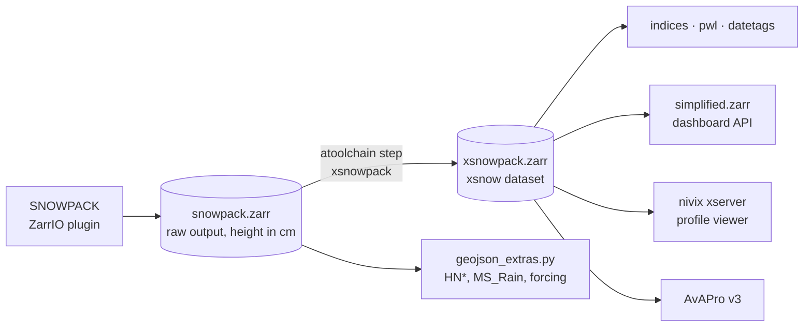

# V. xsnow

<p class="updated">Last updated: 25 Nov 2026</p>

**xsnow** is AWSOME's xarray-based package for SNOWPACK output. It ships with the AWSOME install
(`code/snow-cover/postprocessing/xsnow`) and turns the raw `snowpack.zarr` into one labelled dataset per node,
`xsnowpack.zarr`. Every later step reads it: the stability indices, PWL, datetags, the profile viewer (nivix), and
AvAPro v3.

## 1. Where it sits



<p class="fig-caption"><strong>Figure 1.</strong> xsnow between SNOWPACK and the consumers of the profiles.</p>

- Recipe section: `xsnowpack: {chunks: profile}`.
- In the daily resume, xsnow appends the new nowcast to the season dataset; the forecast hours follow on the same
  time axis.
- Pinned to branch `feat/adashboard` (atoolchain imports `ZarrTailSlopeMismatch` from `xsnow.io.zarr`, which only
  that branch has; tags v1.0.0 and v1.1.0 are older). Switch back to `dev`/`main` once it is merged there.

## 2. Structure of `xsnowpack.zarr`

| Dimension | Content |
|---|---|
| `location` | model points (`R1_ALP`, `W_0001_0017`, `Fidelity`, …) with coords `latitude`, `longitude`, `altitude` |
| `time` | naive UTC, 3-hourly at 00, 03, …, 21 after a first step at 01:00; season + 48 h forecast |
| `slope` | coords `inclination`, `azimuth`: flat + 38° at 0/90/180/270 (stations also 45/135/225/315) |
| `realization` | 1 (deterministic) |
| `layer` | layer 0 = bottom snow element (no soil), surface = `n_layers − 1`, NaN padding above |

Example sizes: `banff_hex` 12 × 419 × 5 × 1 × 23; Whistler up to 123 layers.

!!! tip "Select by coordinate, never by index"
    The slope order is not guaranteed. Use `ds.sel(slope=...)` on `inclination` / `azimuth`. `region_id` and band
    are **not** coords in the store: take them from atoolchain's `<node>/locations.json` (location id → band,
    region_id, elev, lon, lat).

## 3. Variables

=== "Layer variables"

    | Variable | Unit | Note |
    |---|---|---|
    | `height` | m | **vertical** height above ground of the layer top, on every slope |
    | `density` | kg m⁻³ | |
    | `grain_type` | Swiss F1F2F3 code | |
    | `grain_size` | mm | |
    | `temperature` | °C | |
    | `lwc` | fraction | liquid water content |
    | `shear_strength` | Pa | |
    | `rta`, `ssi` | – | SNOWPACK's own RTA (use directly) |
    | `deposition_date` | datetime | minute resolution (~13 µs jitter); merged elements keep the upper date |
    | `datetag` | datetime | mostly NaT; filled by the datetags step |
    | `rc_flat`, `sk38`, `punstable`, `sk38_ccl`, `sk38_ccl_rta` | – | from the `indices` step |
    | pwl flags | – | from the `pwl` step |

=== "Profile variables"

    | Variable | Unit | Note |
    |---|---|---|
    | `HS` | m | snow depth |
    | `SWE` | kg m⁻² | equal across flat and 38° slopes |
    | `n_layers` | – | number of valid layers |
    | `HN3`, `HN6`, `HN12`, `HN24`, `HN72_24` | m | new snow sums |
    | `MS_Snow`, `MS_Rain` | kg m⁻² s⁻¹ / kg m⁻² h⁻¹ | mass fluxes |
    | `VW`, `VW_drift`, `wind_trans24` | m s⁻¹, cm | `VW_drift` ≡ `VW`, `wind_trans24` ≡ 0 (no drift modelled) |

`hardness` is **absent** from all 12 stores.

## 4. Checks done on the stores

| Check | Result |
|---|---|
| Heights vertical or slope-normal? | **Vertical.** SNOWPACK writes `(z + u − z_soil) / cos(slope)`; xsnow is a pass-through (`snowpack.zarr` height / 100 = `xsnowpack.zarr` height, max \|Δ\| 1.2e-7 m). `height[n_layers−1] / HS` = 1.0000 on every slope; HS(38°)/HS(flat) ≈ 1.01–1.03 at first snow, not 0.79. |
| Mass consistency | Σ ρ · Δh (vertical Δh) = `SWE` exactly; SWE equal on all slopes (e.g. 393.5 / 393.6 / 393.2 / 392.2 / 392.5 kg m⁻²). |
| Slope-normal values | build them once: `height_n = height × cos(inclination)` (flat: × 1). |

## 5. Quirks

| Quirk | Effect | Handling |
|---|---|---|
| **06 UTC restart dump** | atoolchain restarts SNOWPACK daily; the first output of each run (06 UTC) is the state plus one step, and the hazard data are not dumped: `HN*`, `MS_*`, `wind_trans24` = 0 there. Layers, HS, SWE and dates are valid. | `geojson_extras.py` repairs `hn24`; AvAPro v3 rebuilds HN3/6/12/24 from the flat profile's layers with SNOWPACK's own rule |
| `HN72_24` = `HN24` in restart segments | the 72 h buffer restarts with each run | do not use as a 3-day sum |
| No drift | `SNOW_EROSION` and `SNOW_REDISTRIBUTION` off | wind-slab detection uses wind speed + surface grains, not drift |
| Irregular Δt | first step 01:00, then 3-hourly | read Δt from the data; windows are durations |
| No forecast flag | nowcast and forecast share the time axis | build the mask from `date_opera` (`<day>T06`) |

## 6. Reading a store

```python
import xarray as xr

ds = xr.open_zarr("/opt/awsome/whistler_hex/xsnowpack.zarr")
north = ds.sel(slope=(ds.azimuth == 0) & (ds.inclination == 38))
prof = ds.sel(location="W2_TL", time="2026-11-20T12:00")
```

Files next to it in `/opt/awsome/<node>/`:

| File | What |
|---|---|
| `snowpack.zarr` | raw SNOWPACK output (heights in cm) |
| `simplified.zarr` | most critical layer per index, for `/api/timeseries` |
| `locations.json` | id → band, region_id, region_name, elev, lon, lat |
| `datetags.json` | weak-layer date tags per region × band |
| `geojson/<stamp>.<F\|N\|E\|S\|W\|nan>.json` | dashboard features, 6-hourly, whole season |
| `snow-nowcast/` | `.sno` resume state |
| `report.json` | atoolchain run report |
